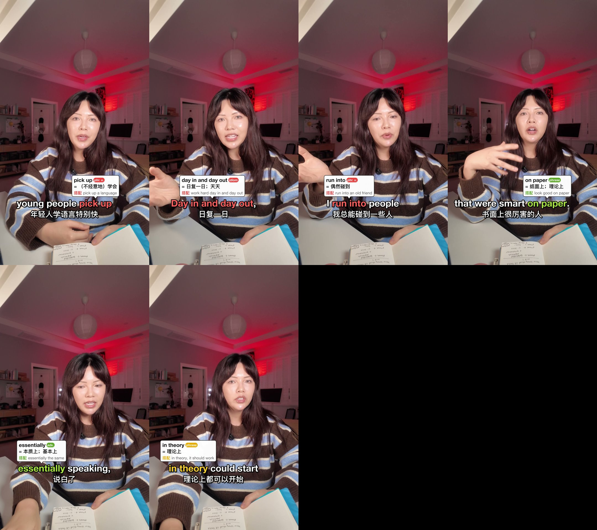

# vocab-bubble-captions

A Claude Code skill that turns a video into a captioned lesson for Chinese learners of English. It transcribes the video (or takes your bilingual SRT), translates each clause, picks teachable vocabulary in three tiers, and burns in EN + 中文 captions. Small white speech bubbles float above the highlighted words, each showing the word, part of speech, 中文 meaning and a simple collocation.



## Install

In Claude Code:

```
/plugin marketplace add <your-github-username>/vocab-bubble-captions
/plugin install vocab-bubble-captions@vocab-bubble-captions
```

Or copy `skills/vocab-bubble-captions/` into `~/.claude/skills/`.

## Requirements

- `uv` (Pillow; faster-whisper with `av<17` for transcription)
- `ffmpeg` (no libass needed; everything is drawn with Pillow)
- macOS for the default fonts: Helvetica Neue for English and PingFang for 中文 (a downloadable macOS font asset). On other systems, change the paths in `scripts/style.py`.
